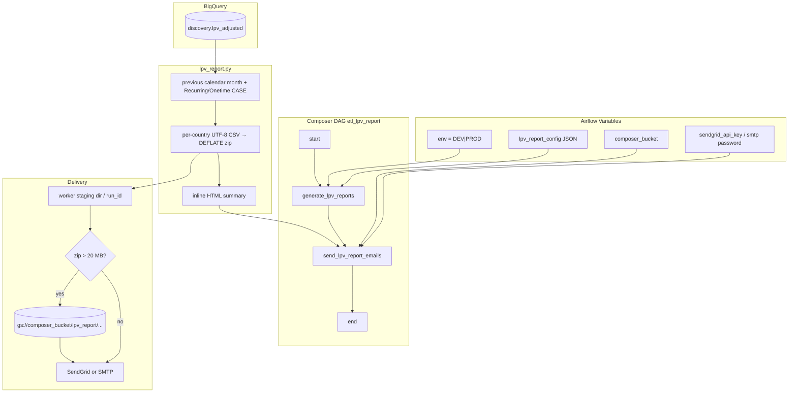

# Architecture: LPV Adjustment monthly report

Composer owns the graph. `lpv_report.py` owns the SQL, country zip,
and HTML. `email_delivery.py` owns transport. `email_tasks.py`
adds a SendGrid size guard that offloads oversized zips to GCS
before send. Airflow Variables map into environment variables so
the notebook-shaped entrypoint stays runnable locally.

## Diagram

## Components

**config.py**  
Reads `lpv_report_config`, resolves project/dataset/table, writes
`BQ_*` / `EMAIL_*` / `SMTP_*` into `os.environ`. Always overwrites
`EMAIL_TO` with `REPORT_RECIPIENTS`.

**report_generator.py**  
Resolves the report module (Composer sync path, else this folder),
importlib-loads `lpv_report.py`, stages under a per-`run_id`
directory, returns the email payload list for XCom.

**lpv_report.py**  
Previous-month filter, revenue-model CASE, country zip, HTML body.
Empty extract returns `[]` so send becomes a no-op success.

**email_tasks.py + email_delivery.py**  
XCom pull → size check → optional GCS offload → `EmailMessage` →
SendGrid API or SMTP with TLS. Zip MIME type is set from filename.

## Design notes

Dynamic import keeps the notebook entrypoint (`generate_reports`)
callable without packaging it as an Airflow plugin. The cost is a
path convention on Composer.

The 20 MB guard is the production lesson: multi-country months can
blow past SendGrid after base64. Prefer a GCS URI in the HTML over
a hard failure — finance still gets the file, ops still gets a green
DAG when the only problem was attachment size.
