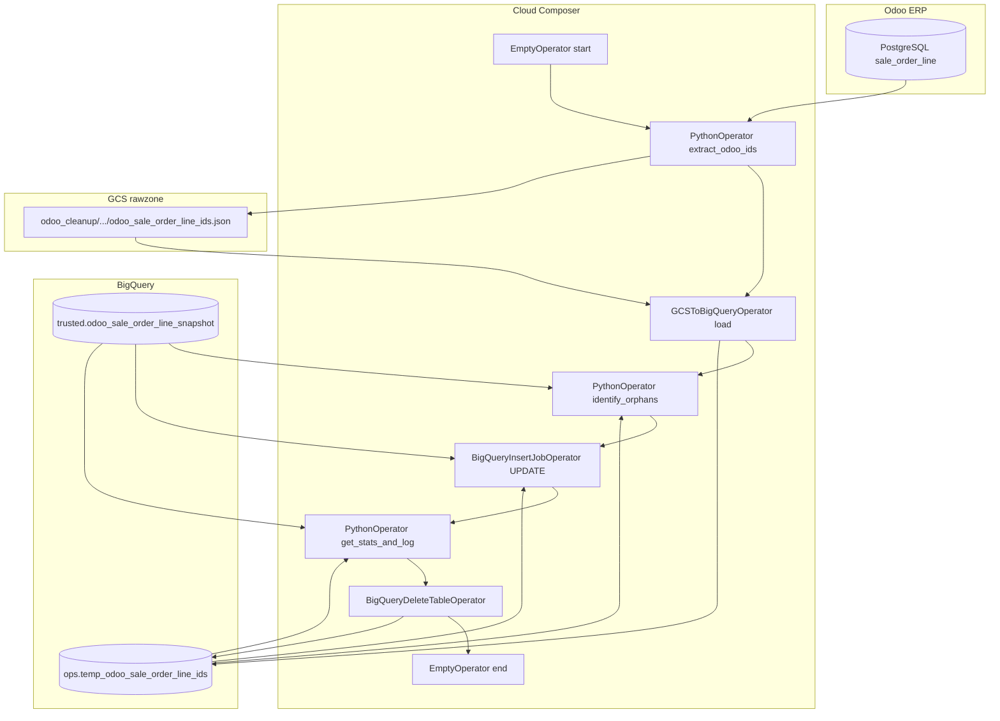

# Architecture: sale_order_line snapshot soft-close

Composer extracts live Odoo IDs to GCS, loads them into a BigQuery
temp table, soft-closes open snapshot orphans, logs sync bands, then
drops the temp table.

## Diagram

## Components

**DAG (`dag_sale_order_line_snapshot_cleanup.py`)**  
Env-aware project, bucket, and Odoo creds from Airflow Variables.
Seven sequential tasks (`max_active_runs=1`). Schedule
`0 2 * * 0`. Extract timeout 30 minutes. GCS object path templates
`{{ ds }}` so re-runs stay interval-scoped.

**Postgres client (`odoo_postgres.py`)**  
Lazy connect with three attempts and backoff. Production originally
imported a full pull class; cleanup only needs a cursor for
`SELECT id`.

**Orphan contract**  
Open snapshot row (`dbt_valid_to IS NULL`) whose `id` is absent from
the temp Odoo ID table. Soft-close sets `dbt_valid_to` — no DELETE.

## Failure modes

| Mode | Behaviour |
|------|-----------|
| Odoo Postgres connect flake | Up to 3 attempts with backoff; then task fails + retries |
| GCS upload / BQ load failure | Task fails; snapshot unchanged |
| Identify query failure | Raises; UPDATE does not run |
| UPDATE succeeds, stats query fails | Stats logs XCom counts and continues |
| Temp table missing on cleanup | `ignore_if_missing=True` |
| Significant sync band (>1000) | Logged only — operator investigates; DAG still succeeds |
