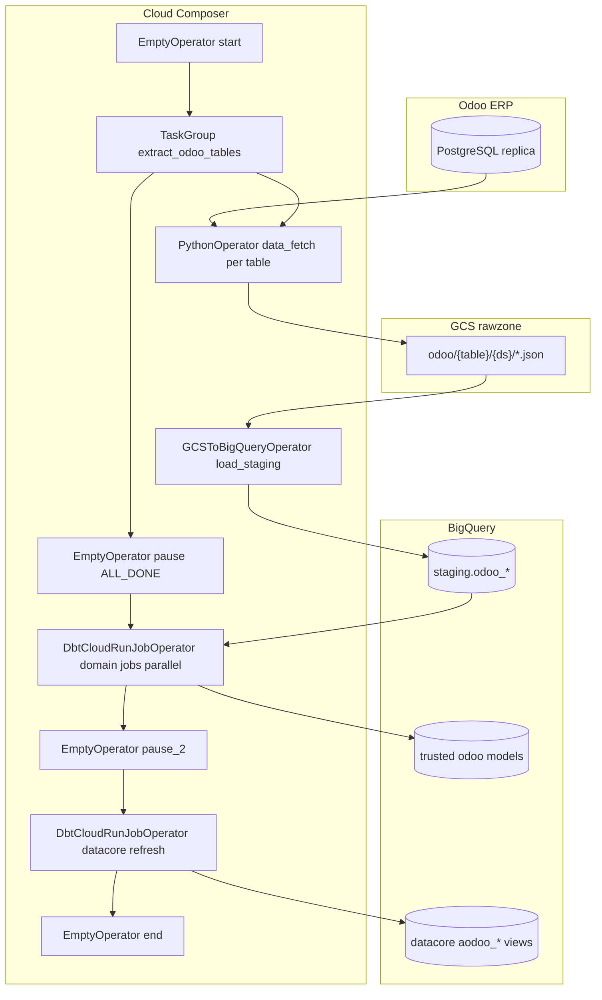

# Architecture: Odoo DWH full extract

Composer reads the Odoo Postgres replica, lands NDJSON in the rawzone,
loads staging with `WRITE_TRUNCATE`, waits for all extract/load pairs,
runs domain dbt Cloud jobs in parallel, then refreshes datacore views.

## Diagram

## Components

**DAG (`dag_odoo_dwh_import.py`)**  
Env-aware project, bucket, and Odoo creds. One extract TaskGroup at
parse time. `max_active_runs=1`, `max_active_tasks=80`,
`dagrun_timeout=8h`. Schedule `0 1 * * *`. Fetch timeout 300 minutes
per table. dbt tasks are deferrable with 60-minute Airflow
`execution_timeout` and 3600s Cloud wait.

**Extract class (`odoo_data_export.py`)**  
Lazy Postgres connect (3 attempts + backoff). Shared
`pull_odoo_data` / `pull_table_data` with special cases for
`mail_message` (SFDC activity join + folder rename), CRM log notes,
jsonb team names, incremental lookback list, and 50k-row chunks for
`account_tax_sale_order_line_rel`.

**Connect helper (`odoo_postgres.py`)**  
PgBouncer-safe SSL kwargs. No credentials in code.

**Staging load**  
`NEWLINE_DELIMITED_JSON`, schema objects under `schema_json/`,
`allow_quoted_newlines=True`, destination `staging.odoo_{folder}`.

## Failure modes

| Mode | Behaviour |
|------|-----------|
| Postgres connect flake | Up to 3 attempts with backoff; task retries (3 × 20 min) |
| Empty chunk dir for tax/SOL rel | `FileNotFoundError` — task fails |
| Single table extract fails | Other tables continue; `pause` is `ALL_DONE` so dbt still runs |
| dbt HTTP hung | `execution_timeout` kills the task; `dagrun_timeout` frees the slot |
| Schema mismatch on load | GCSToBigQuery fails for that table; staging for others still land |
| Partial dbt success | Datacore waits on `pause_2` (`ALL_DONE`); inspect per-job status |
