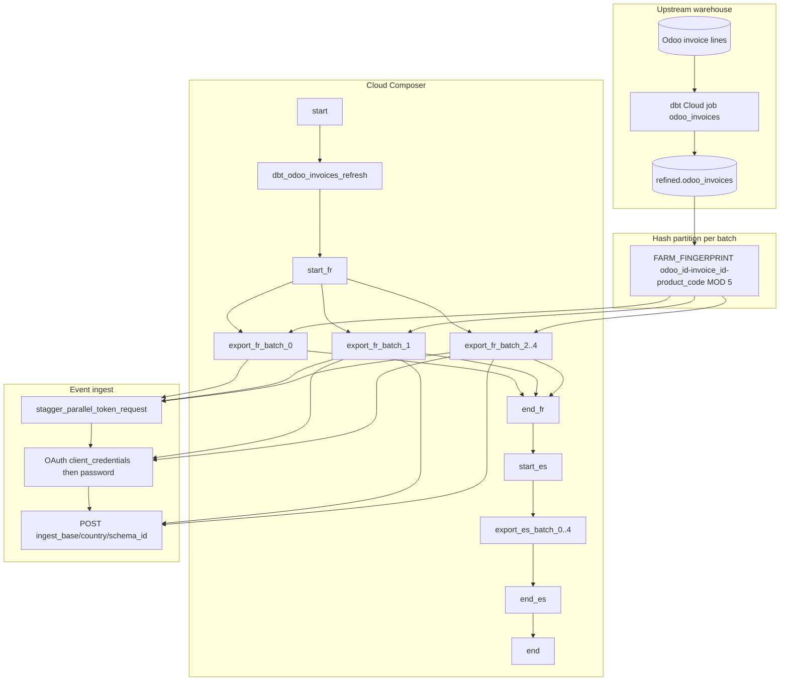

# Architecture: Odoo invoices partner export

One dbt refresh, then sequential per-country blocks (FR → ES).
Inside each country, five hash partitions stream BQ rows to Avro
bulk ingest. The DAG owns concurrency; the export module owns
OAuth + encode + POST.

## Diagram

## Components

**odoo_invoices_export**  
Builds the `FARM_FINGERPRINT … MOD N = batch` SELECT, streams the
BQ iterator, Avro-encodes each row, and POSTs chunks of 1000.
Schema is parsed once per batch. OAuth prefers
`client_credentials`, retries throttled IdP responses via
`acquire_token_with_retry`, then falls back to password grant.
401 on ingest clears the token and retries the same payload.

**event_api_auth**  
`stagger_parallel_token_request` + `acquire_token_with_retry`.
Copied from the same production helper used by other partner
exports; critical when five batch tasks wake together.

**DAG ordering**  
`start → dbt → {start_cc → [batch_0..4] → end_cc}×countries → end`.

Countries are chained (`end_fr → start_es`). Batches inside a
country fan out under `max_active_tasks=3`, so at most three of
the five shards run concurrently. That is intentional pool
tuning — not an accidental match to `TOTAL_BATCHES`.

## Failure surfaces

| Failure | Effect | Recovery |
|---------|--------|----------|
| dbt job timeout / fail | No export tasks run | Fix dbt, clear and re-run |
| IdP 403 storm | Batch tasks retry with backoff | Stagger + raise pool carefully |
| Single batch fail | Sibling batches may still finish; `end_cc` is ALL_DONE | Re-run failed task only |
| Partner 5xx | Linear backoff up to 10 attempts | Check partner status; re-run batch |
