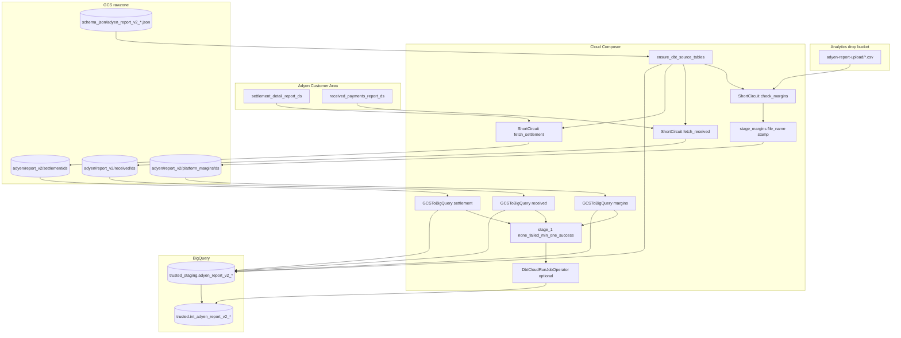

# Architecture: Adyen report land v2

Composer downloads yesterday's Adyen Customer Area report CSVs (or picks
up a margins drop), stamps file lineage, loads typed staging via schema
JSON, and optionally triggers dbt. Three parallel branches join at
`stage_1` with a soft success rule so empty days do not fail the run.

## Diagram

## Components

**DAG (`dag_adyen_report_land_v2.py`)**  
Schedule `30 5 * * *`, `max_active_runs=1`, 2-hour timeout. `REPORT_DATE`
is `{{ ds }}` (previous calendar day). Settlement and received branches
use ShortCircuit callables that return falsy when Adyen has no file.
Margins ShortCircuit when the drop folder is empty. dbt runs only when
`adyen_report_v2_dbt_job_id` is set (PROD).

**Helper (`adyen_report_land_v2.py`)**  
`AdyenReportClient` streams CA downloads with API-key or basic auth,
retries transient HTTP errors, and treats 404 as "not published yet."
`fetch_*_date_range_to_gcs` clears the day prefix, probes candidate
filenames, optionally stamps `file_name`, and uploads a stable object
name for single-day loads. `stage_drop_csvs_with_file_name` copies each
margins CSV without merging. `ensure_dbt_source_tables` maps schema JSON
types to BQ DDL and creates missing staging tables only.

**Schema JSON (`schema_json/`)**  
Same objects referenced by `GCSToBigQueryOperator` and by ensure-tables.
Every schema ends with `file_name STRING`.

## Failure modes

| Mode | Behaviour |
|------|-----------|
| Adyen 404 for the day | ShortCircuit skips that branch; other branches continue |
| Empty margins drop | ShortCircuit skips margins; v1 may still own archive |
| All three branches skip | `stage_1` still succeeds if ensure ran (`none_failed_min_one_success`) |
| Schema JSON missing | ensure / load fail; fix object before retry |
| dbt Variable empty | Skip dbt; staging land still completes |
| Transient CA HTTP errors | Up to 3 retries with 60s delay inside the client |
