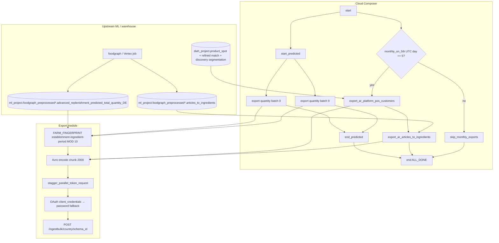

# Architecture: Advanced Replenishment partner export

Composer runs a daily quantity arm (10 parallel hash batches) and a
monthly reference arm gated on the 5th UTC. The DAG owns branching,
concurrency, and timeouts; the export module owns OAuth, encode, and
POST.

## Diagram

## Components

**TOTAL_BATCHES = 10**  
Daily quantity is wide (establishment × ingredient × period). Ten
`FARM_FINGERPRINT` slices keep each worker's BQ scan and Avro buffer
bounded. Composite key is `establishment_id || ingredient_name_local
|| period_start_date` so related rows stay in one batch.

**monthly_on_5th**  
`BranchPythonOperator` returns either the customer export task id or
`skip_monthly_exports`. Customer and articles tasks are chained;
skip is a single EmptyOperator. Both paths converge on `end`
(`ALL_DONE`).

**advanced_replenishment_export**  
Builds typed SELECTs, streams the BQ iterator, Avro-encodes each
row, POSTs chunks of 2000. Schema parsed once per task. OAuth tries
`client_credentials` across configured secrets (with throttle-aware
retry), then password-grant; 401/403 on ingest clears the token and
retries the same chunk.

**event_api_auth**  
`stagger_parallel_token_request` + `acquire_token_with_retry`.
Without stagger, ten batches that land together will 403 the IdP
and cascade into password-grant load. Keep this helper local to the
pattern so the concurrency contract travels with the code.

## Why branch instead of a second DAG?

A separate monthly DAG would need its own schedule, Variables
checklist, and on-call mental model for two reference tables that
only make sense beside the daily quantity feed. Branching keeps one
`dag_id`, one OAuth surface, and one place to raise
`max_active_tasks` when batches grow.

## Why not delta / watermark on quantity?

The upstream prediction table is rebuilt as a full snapshot. A
row-hash delta would chase moving `total_ingredient_quantity` values
the partner already treats as replace-by-subject. Full reship with
hash partitions is cheaper to reason about than a brittle
fingerprint across ranked ingredient lists.
