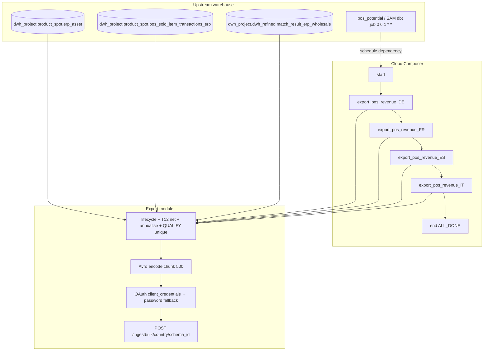

# Architecture: Platform POS revenue potential export

Composer runs one monthly DAG. Countries execute sequentially; each
task owns its own BQ stream, Avro encode, and chunked POST. The DAG
owns schedule, concurrency, and timeouts; the export module owns
OAuth, the revenue SQL, and ingest.

## Diagram

## Components

**Sequential countries**  
`COUNTRY_ISO_CODES = ["de", "fr", "es", "it"]` with
`max_active_tasks=1`. Parallel markets would fight the same IdP and
ingest quota for a full-table stream that already has a 4-hour
timeout. Order is stable so on-call can resume from the failed
country task.

**Revenue SQL (`_build_query`)**  
Four CTEs:

1. `pos_lifecycle` — earliest onboarding + latest asset status for
   POS licence product codes
2. `latest_dates` — last POS workday per establishment
3. `pos_sale_days` — distinct sale days in the trailing 12 months
4. `pos_potential` — net revenue with a ≥4 Monday-week coverage gate

Final SELECT annualises when
`DATE_DIFF(last, onboard, DAY) BETWEEN 0 AND 364` and status is not
`Suspended`, then `QUALIFY` keeps only unique
(country, customer_no, home_store_id) rows.

**EventIngestAPI**  
`client_credentials` across configured secrets first, password-grant
fallback, optional realm Variable. Mid-load 401 clears the token and
retries the same chunk — monthly runs often outlive short-lived
access tokens.

## Why sequential instead of hash batches?

Unlike Advanced Replenishment quantity (pattern 78), this population
is customer-grain and already filtered to matched wholesale keys.
Four countries × one stream each fits the monthly window without
`FARM_FINGERPRINT` partitioning. If a single market exceeds the
4-hour timeout, add hash batches *for that country* rather than
parallelising all markets.

## Why revisit annualisation in SQL?

The partner schema wants both trailing net and annualised potential.
Keeping the CASE in the export SELECT (instead of reading a
pre-materialised column alone) makes the Avro contract auditable in
one place and keeps this DAG usable even when the SAM table lags a
rebuild — as long as asset + transaction + match are current.
