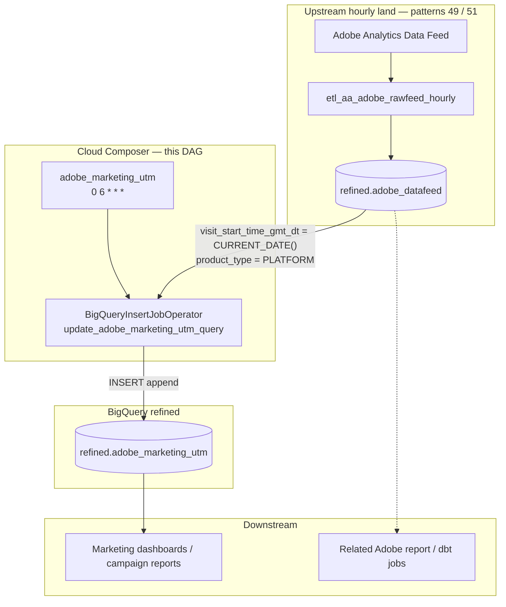

# Architecture: Adobe marketing UTM attribution

Hourly Adobe datafeed land fills a refined hit table. Once per day,
Composer runs a single BigQuery INSERT that projects today's website
visits into a marketing attribution table with funnel flags, referral
channel pivots, and UTM eVars.

## Diagram

## Components

**DAG (`dag_adobe_marketing_utm.py`)**  
Single task. Schedule `0 6 * * *`. `catchup=False`. `retries=0` as
shipped. Project, refined dataset, and product-type filter come from
Airflow Variables (`dwh_project_id`, `refined_dataset`,
`adobe_utm_product_type`).

**SQL (`adobe_marketing_utm_query.py`)**  
`build_insert_sql` returns the INSERT…SELECT. Derived columns:

| Group | Columns | Rule |
|-------|---------|------|
| Identity | `visitor_id` | `CONCAT(visid_high, "_", visid_low)` |
| Funnel | `reached_pricing_page`, `BT_click_request_demo`, `BT_click_Form_submit` | visit_id if event/URL match, else NULL |
| Referral | `Inside_your_site`, `Other_web_sites`, `Search_engines`, `Typed_Bookmarked_no_referrer`, `Social_Networks` | visit_id if `referrer_type_id` in {1,2,3,6,9} |
| UTM | `var_interaction_marketing_{source,medium,campaigns}` | pass-through eVars |
| Sequence | `visit_page_num` | pass-through |

**Config**  
No GCS, no OAuth, no partner bus — BigQuery only via
`bigquery_default`.

## Failure modes

| Mode | Behaviour |
|------|-----------|
| Upstream partition empty / late | Zero-row insert; DAG still green |
| Same-day re-run | Duplicate rows (no idempotency) |
| Transient BQ error | Immediate fail (`retries: 0`) |
| Product-type Variable wrong | Silent empty or wrong population |
| No upstream sensor | Race with hourly land at 06:00 |
