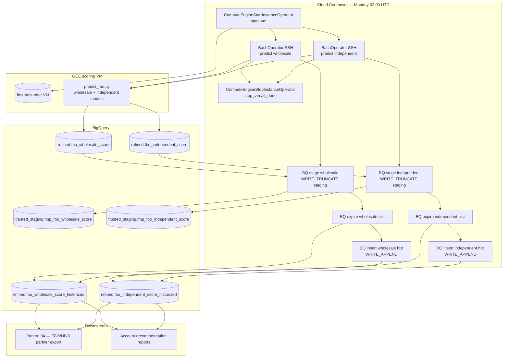

# Architecture: First Best Offer scoring SCD

Weekly Composer DAG that boots a scoring VM, runs two predict jobs in
parallel over SSH, then historises each population into refined with
hash-based SCD Type 2.

## Diagram

## Components

**VM lifecycle**  
`ComputeEngineStartInstanceOperator` / `StopInstanceOperator` around
the predict window. Zone, project, and VM name are Airflow Variables
(`fbo_gce_*`). Stop uses `TriggerRule.ALL_DONE`.

**Predict (BashOperator + SSH)**  
Composer copies an SSH private key from the Composer data bucket, then
SSHs into the VM and runs `predict_fbo.py` with `--model=wholesale` or
`--model=independent`. PYTHONPATH + venv activation happen on the
remote side. The model code itself is not shipped in this folder.

**SCD SQL (`fbo_scd_queries.py`)**  
Three builders per arm: `stage_sql`, `expire_sql`, `insert_sql`. Arms
differ only by key column and table names (`FboScoreArm` dataclass).

| Column | Role |
|--------|------|
| `_keyhash` | MD5 of business key (account or establishment id) |
| `_rowhash` | MD5 of full row JSON — content identity |
| `_valid_from` / `_valid_until` | Version window; open end = `2099-12-31` |
| `_valid_flag` | Fast filter for current version |
| `_job_name` / `_sourcesystem` | Lineage (`etl_first_best_offer` / `scoring`) |

**Config**  
No partner OAuth, no GCS land, no dbt. BigQuery via `bigquery_default`
(Variable `dwh_gcp_conn`). Datasets default to `refined` /
`trusted_staging`.

## Failure modes

| Mode | Behaviour |
|------|-----------|
| VM start fails | Both predicts skip; stop still runs (`all_done`); no SCD |
| One predict fails | Other arm can still historize; stop still runs |
| Stage `all_done` after failed predict | May historize stale score table — known footgun |
| SSH key missing in GCS | Predict BashOperator fails |
| Schema drift on score table | Mass expire+insert (rowhash covers whole row) |
| Overlapping Monday runs | Blocked by `max_active_runs=1` (added in sanitization) |
