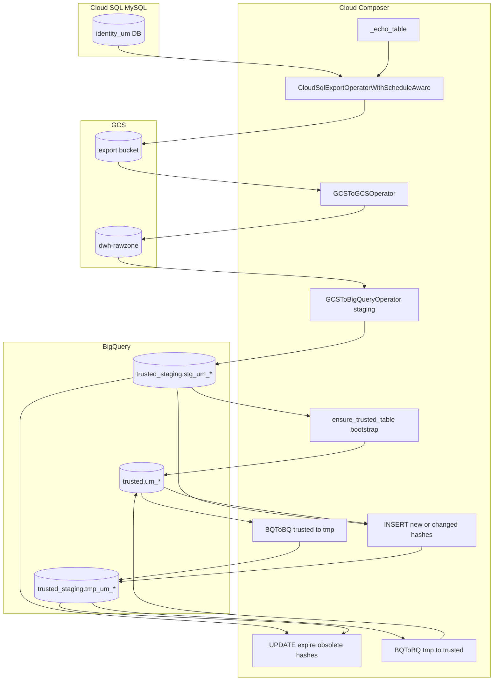

# Architecture: User Management Cloud SQL SCD Type 2

Composer owns extract, dual-bucket land, staging load, and in-DAG Type 2
historization for the identity MySQL database. Cloud SQL Admin exports
are serial; each table then runs its own BigQuery SCD chain.

## Diagram

## Components

**DAG (`dag_user_management_scd.py`)**  
Daily `0 7 * * *`, `max_active_runs=1`, 300-minute timeout. Serial
export chain via `last_export >> _echo_next`. Per table: nine tasks.
Production ran ~28 tables (~250 tasks); this reference keeps eight.

**Catalog (`um_table_config.py`)**  
Inline schemas + MySQL SELECTs that emit `UM_` surrogate keys,
`_keyhash` / `_rowhash`, and ETL audit columns. Hash-at-source keeps
BigQuery SCD to a concat compare.

**Operator (`cloudsql_export_operator.py`)**  
Same family as patterns 39 / 54: retry 409 `operationInProgress`,
double delay inside the backup window (default 03:00–05:00 UTC). UM
production used 8 retries × 10 minutes.

**Bootstrap**  
If `trusted.um_{table}` is missing, create it from staging schema and
add `_valid_*` columns before the SCD UPDATE/INSERT.

## Failure modes

| Mode | Behaviour |
|------|-----------|
| Cloud SQL 409 during backup | Schedule-aware backoff; up to 8 retries |
| Export OK, GCS copy fails | `ALL_DONE` on download still fires; load may miss object → fail |
| Staging load jagged rows | `max_bad_records=100`, `allow_jagged_rows=True` |
| Trusted missing on first run | Bootstrap creates empty table from staging |
| Staging missing on bootstrap | Raises; SCD chain does not proceed |
| Hash expire / insert SQL fail | Tmp may be partial; promote skipped if task fails |
