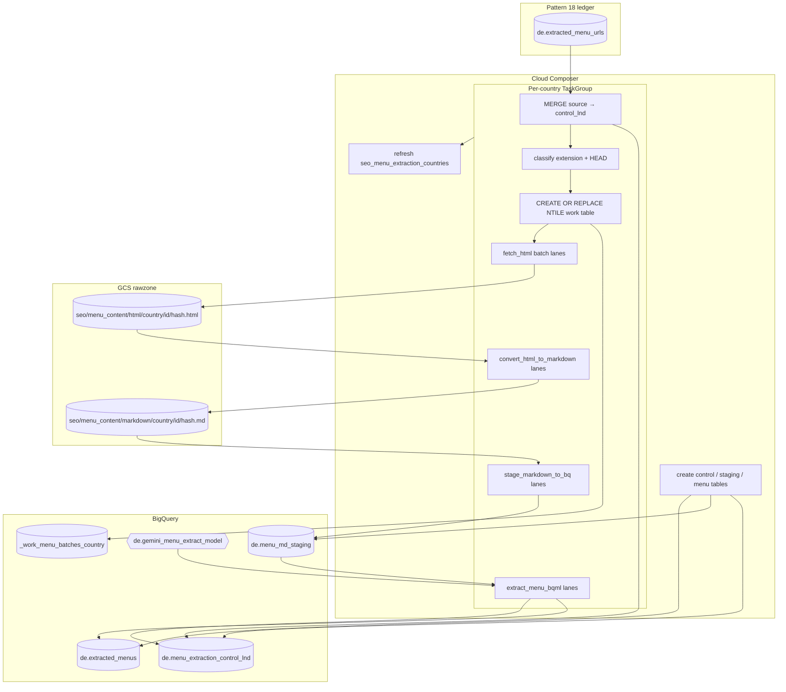

# Architecture: SEO menu content extraction

Composer reads the menu URL ledger from pattern 18, maintains a control
landing table, and runs per-country TaskGroups: classify → plan batches →
parallel fetch / convert / stage / BQML lanes. Artifacts live in the
rawzone under content-addressed paths; the final menutable is an
idempotent MERGE on `menu_id`.

## Diagram

## Components

**DAG (`dag_menu_content_extraction.py`)**  
`schedule_interval=None`, `max_active_tasks=10`, `max_active_runs=1`.
Ensures three clustered tables, then chains country TaskGroups built from
Variable `seo_menu_extraction_countries`. Empty Variable → create tables
+ refresh Variable only (next parse materializes groups).

**Classify (`classify_menu_url_types.py`)**  
SQL update for clear extensions; HEAD (GET fallback) for ambiguous URLs.
SSL verify-false retry for broken restaurant certs. Statuses:
`classified` / `skipped_non_html` / `classify_failed`.

**Fetch / convert / stage**  
Threaded workers (5) per batch. SHA-256 content hash names HTML/MD
objects; stale siblings under the same `menu_url_id` folder are deleted.
Temp JSON load + MERGE updates control (and staging for the stage step).
`attempt_count` increments only on stage failure and resets on progress.

**BQML (`extract_menu_bqml.py`)**  
`AI.GENERATE_TABLE` with temperature 0 and a page-level output schema.
Successful rows MERGE into `extracted_menus` on `menu_id`; failures stay
`bqml_failed` for the next run (up to 3 attempts).

## Failure modes

| Mode | Behaviour |
|------|-----------|
| Empty country Variable | Tables created; Variable refreshed; no extract lanes |
| Non-HTML URL (pdf/png/jpeg) | `skipped_non_html`; never enters fetch |
| Transient DNS / timeout on classify or fetch | Status `*_failed`; retry until attempt cap |
| Batch slot beyond planned count | Task noops via XCom plan |
| Sibling batch fails | `ALL_DONE` on lanes; other slots continue |
| BQML status non-empty | Row stays `bqml_failed`; menutable untouched for that key |
| Re-fetch after content change | New hash object; old sibling deleted; MERGE updates URI |
