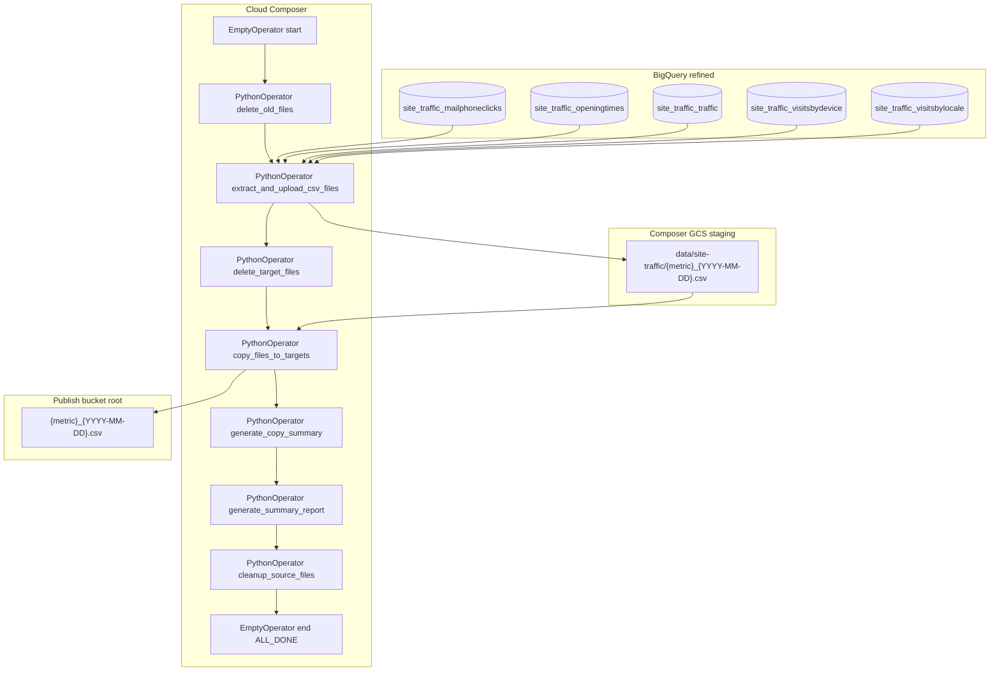

# Architecture: Hydra Adobe traffic CSV publish

Composer reads five refined site-traffic tables from BigQuery for a
two-day window, stages CSVs on the Composer bucket, overwrites the
publish bucket for those dates, then cleans staging and applies
60-day retention on the consumer side.

## Diagram

## Components

**DAG (`dag_hydra_adobe_traffic_csv.py`)**  
Linear chain. Schedule `0 7 * * *`. `dagrun_timeout=12h`. Extract
timeout 6h; copy 2h; retention/overwrite 1h each. `end` uses
`ALL_DONE` so a mid-chain failure still closes the run for scheduling.

**Helpers (`traffic_csv_export.py`)**  
Table list + short-name mapping, date window, pandas extract with
`d-m-yyyy` date formatting and device-type remaps for visits-by-device,
target delete for the window, GCS copy to bucket root, staging cleanup
gated on successful copy, retention by parsing dates from filenames.

**Config**  
Project, dataset, Composer bucket, staging folder, and publish bucket
come from Airflow Variables with sanitized defaults
(`dwh_project_id`, `refined_dataset`, `composer_bucket`,
`site_traffic_staging_folder`, `site_traffic_publish_bucket`).

## Failure modes

| Mode | Behaviour |
|------|-----------|
| Empty table/date | Logged as `no_data`; other extracts continue |
| Single extract exception | Logged as `error` in results; loop continues |
| Copy failure | Staging file kept; cleanup skips that object |
| Target list/delete flake | Task retries (1 × 5 min); may leave stale objects until next run |
| Publish bucket growth | Full-object list for retention/overwrite slows; monitor object count |
| Module-level date window | Backfill / reparse can miss intended logical dates — known debt |
