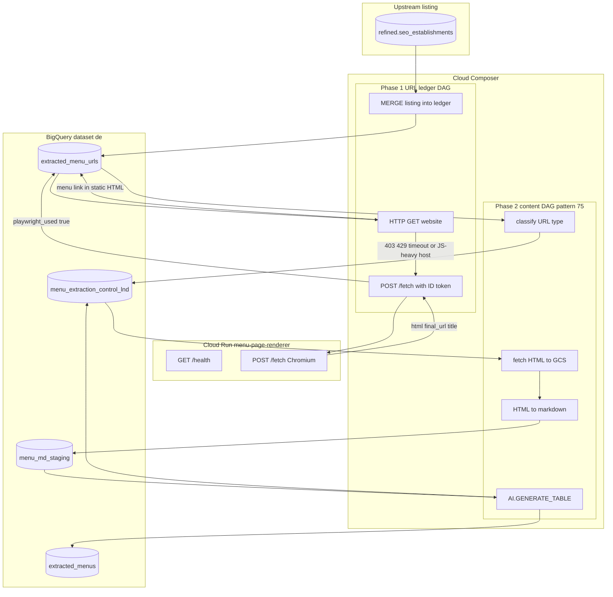

# Architecture: menu extraction

Two DAGs, one renderer, four BigQuery tables.

Phase 1 finds the menu URL. Plain HTTP first. Cloud Run (headless Chromium) only when the page is JS-rendered or the site blocks the worker. Phase 2, pattern 75, turns that URL into a page-level menu row. This diagram is the whole process. The task-level graphs stay in patterns 18 and 75.

## Diagram

## Components

**Cloud Run (`cloud_run/app.py`)**  
Private service. `GET /health`. `POST /fetch` with `{"url": "..."}`. Launches Chromium, waits for DOMContentLoaded plus a short settle, returns HTML, final URL, and title. gunicorn timeout 300s. No unauthenticated invoke. Composer calls it with a Google ID token whose audience is the service URL (`playwright_scraper_url`).

**Phase 1 DAG (`dag_menu_extraction.py`)**  
Reads `refined.seo_establishments`. MERGEs new establishments into `de.extracted_menu_urls` on `establishment_id` + `places_id`. Rows that already carry `menu_url` skip the renderer. Everyone else: HTTP, then Cloud Run on 403 / 429 / 503 / timeout, or when the host is on the JS-heavy list. `playwright_used` records which path won. Pattern 18 is the full country × NTILE task graph; this file is the contract those tasks implement.

**Phase 2**  
Pattern 75. Not re-implemented here. It MERGEs the ledger into `menu_extraction_control_lnd`, classifies HTML vs pdf/image, fetches HTML to GCS, stages markdown, and MERGEs `AI.GENERATE_TABLE` output into `extracted_menus` on `menu_id`.

**Tables (`bq/tables.sql`)**  
Clustered the way the DAGs filter: country, then establishment or `menu_url_id`. `CREATE TABLE IF NOT EXISTS` so a rerun does not drop history.

## Failure modes

| Mode | Behaviour |
|------|-----------|
| `playwright_scraper_url` unset | HTTP only. `playwright_used` stays false. Warning in the task log |
| Cloud Run 5xx or missing `html` | Same HTTP fallback. Ledger status `fetch_failed` if HTTP also fails |
| Source row already has `menu_url` | No render. Copied onto `fetched_menu_url` |
| Non-HTML URL in phase 2 | `skipped_non_html` on the control table. No GCS object |
| Empty country Variable | Tables created, variable refreshed, no country groups this parse |
