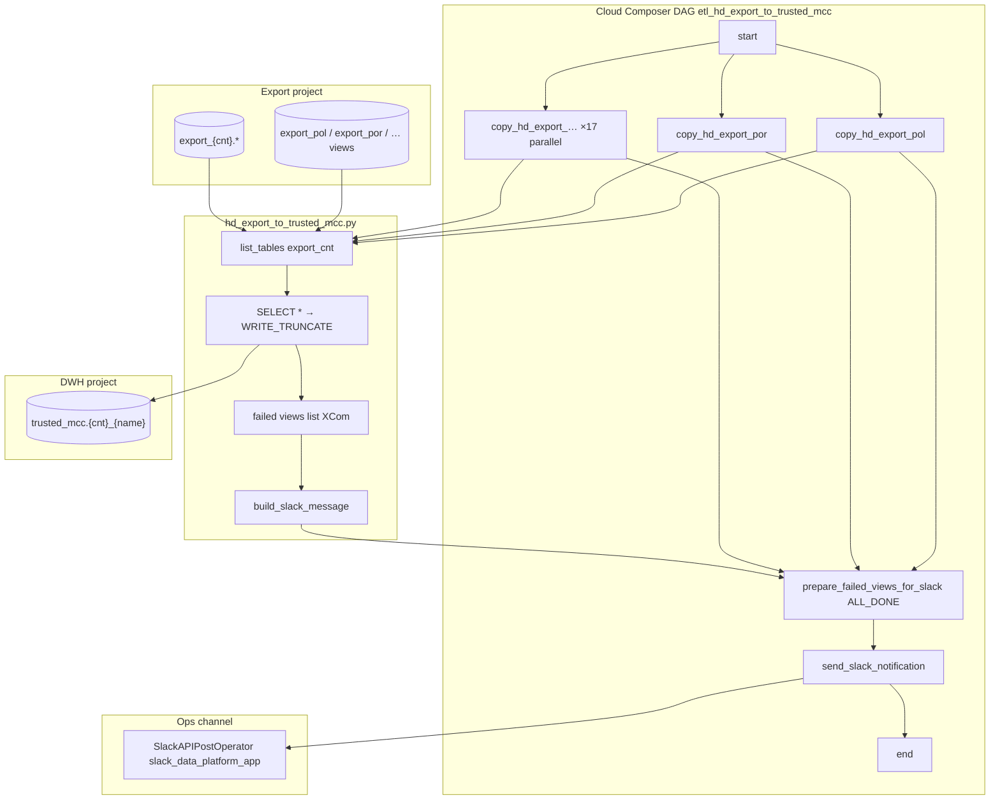

# Architecture: HD export → trusted MCC materialization

Composer owns schedule, parallel country fan-out, and Slack
posting. The helper module owns list → SELECT * → WRITE_TRUNCATE
and the Slack text contract. Stock BigQuery client does the copy;
no custom operator.

## Diagram

## Components

**Parallel country tasks**  
`COUNTRY_SUFFIXES` drives one `PythonOperator` per market. `chain`
puts all copy tasks between `start` and the prepare step so they
run concurrently. Seventeen markets finish in roughly the wall
time of the slowest country, not the sum.

**copy_country**  
Lists up to 1000 objects in `export_project.export_{cnt}`. Each
object becomes `dwh_project.trusted_mcc.{cnt}_{name}` via a query
job with `WRITE_TRUNCATE`. GoogleAPIError on a single view is
recorded and the loop continues. Dataset-level list failure skips
the country (empty list) — prefer skip over failing the whole DAG
when one market's dataset is temporarily missing.

**Failure aggregation**  
Prepare runs with `TriggerRule.ALL_DONE`. It inspects task-instance
state for hard failures and flattens XCom lists for soft view
failures, then drops `SKIP_FAILED_VIEWS`. Slack text distinguishes
DAG Failure / completed with failed views / Success. Channel id
should come from an Airflow Variable in real Composer.

## Why parallel countries, not a single loop?

A single task looping seventeen datasets serializes BQ slots and
makes one stuck market block the overnight window. Parallel tasks
isolate retries (three retries × 10 minutes per country) and let
on-call re-run `copy_hd_export_bel` without replaying Poland.

## Why Slack bot instead of webhook?

The previous path base64-encoded XCom into a webhook body. Moving
to `SlackAPIPostOperator` + app connection keeps the bot inviteable
to the ops channel, avoids payload size gymnastics, and makes the
prepare task return plain text XCom that is readable in the UI.
