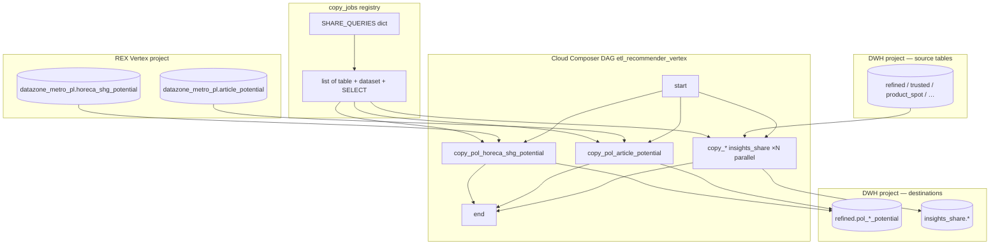

# Architecture: recommender Vertex weekly mirror

Composer owns schedule, parallelism, and the `copy_jobs` loop.
`insights_share_queries.SHARE_QUERIES` owns the SELECT statements
for the insights destination. Stock `BigQueryInsertJobOperator`
does each full-replace copy — no custom operator.

## Diagram

## Components

| Piece | Role |
|-------|------|
| `dag_recommender_vertex_weekly_mirror.py` | ENV → project/conn, build `copy_jobs`, fan-out InsertJobs |
| `insights_share_queries.py` | SELECT-only map keyed by destination table id |
| `BigQueryInsertJobOperator` | BATCH + WRITE_TRUNCATE + CREATE_IF_NEEDED |
| Composer SA | Read on REX market zone + DWH sources; write on dest datasets |

## Design notes

- Registry over TaskGroup sprawl: every mirror looks the same in
  the UI (`copy_{table}`), which makes onboarding and failure triage
  predictable.
- Two destination datasets in one DAG on purpose. Splitting by
  destination would duplicate schedule, retries, and env wiring for
  no independent SLA.
- `max_active_runs=1` stops a slow Monday from overlapping next
  week's truncate and producing confusing double-writer races.
