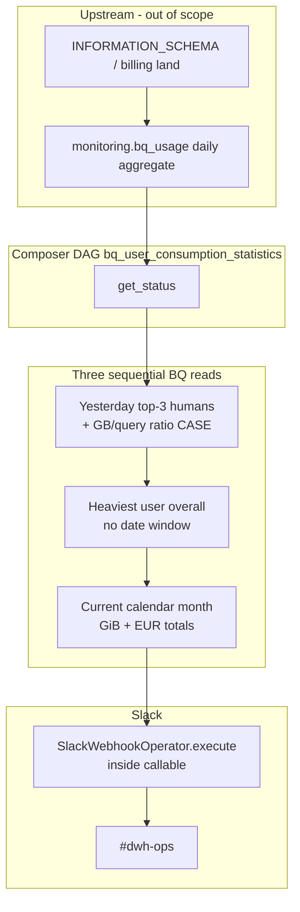

# Architecture: BigQuery consumption Slack digest

One Python task owns three BigQuery aggregations and a Slack webhook
post. Upstream land of `monitoring.bq_usage` is out of scope for this
DAG — Composer only reads and announces.

## Diagram

## Components

**dag_bq_consumption_slack_report.py**  
Single-file pattern: SQL constants, `get_status` callable, DAG
definition. BigQueryHook (EU) for `get_records`. Slack connection id
and channel are module-level constants for the sanitized sample.

**Ratio CASE in SQL**  
Efficiency emoji and rank medal are computed in BigQuery so the
Python side stays a thin formatter. Order of `WHEN ratio > 15`
before `> 10` matters — SQL CASE stops at first match.

**Slack delivery**  
Webhook operator instantiated with `dag=dag` and executed with an
empty context dict. Connection password is read but unused (legacy
leftover); the operator uses `slack_webhook_conn_id`.

## Design notes

Keeping query + format + post in one task matches the original
production shape and keeps the schedule trivial. If Slack rate limits
or webhook outages become common, split post into a second task with
retries and leave the BQ part at `retries: 0` or `1`.
