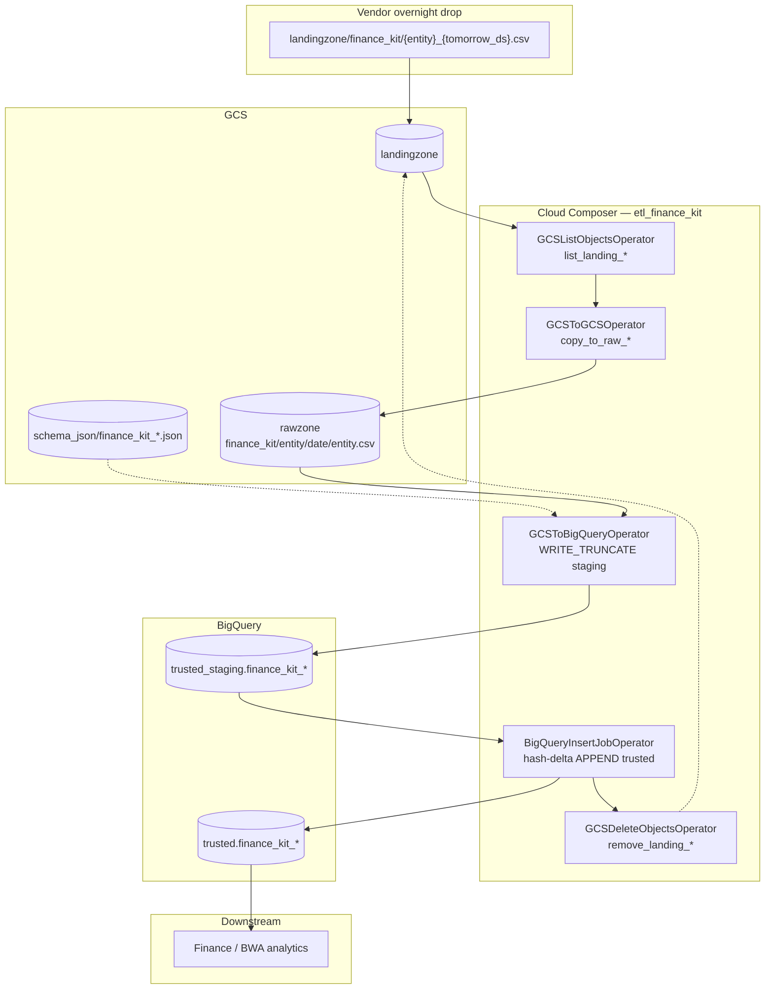

# Architecture: Finance-kit CSV land + hash-delta

Composer fans out one identical operator chain per finance-kit
entity. Stock GCS / BigQuery operators move bytes; a small SQL
builder stamps audit columns and appends unseen hash pairs into
trusted. No custom PythonCallable, no dbt step.

## Diagram

## Components

**DAG (`dag_finance_kit_land.py`)**  
Loop over `ENTITIES`. Schedule `30 23 * * *`. `max_active_runs=1`,
`catchup=False`. Buckets, project, datasets, and conn ids from
Airflow Variables.

**Entity registry (`finance_kit_entities.py`)**  
Ten vendor stems + `build_hash_delta_insert_sql`. SELECT from staging
where `concat(_keyhash,'|',_rowhash)` is not already in trusted;
stamp `_create_ts`, `_sourcesystem`, open-ended `_valid_*`.

**Schemas**  
Per-entity JSON on the load bucket. Must include `_keyhash` and
`_rowhash` columns — the delta predicate depends on them.

**Ordering**  
`list → copy → load → insert → delete`. Delete is last on purpose.

## Failure modes

| Mode | Behaviour |
|------|-----------|
| Vendor late / missing CSV | `list_landing` green with `[]`; `copy_to_raw` fails |
| Schema JSON missing / drift | GCS→BQ load fails; landing file kept |
| Staging load OK, insert fails | Landing kept; staging holds today's truncate |
| Identical re-drop | Insert selects zero rows; landing still deleted |
| Changed row, new `_rowhash` | New trusted row appended; prior version not closed |
| One of ten entities fails | Other entity chains continue independently |
