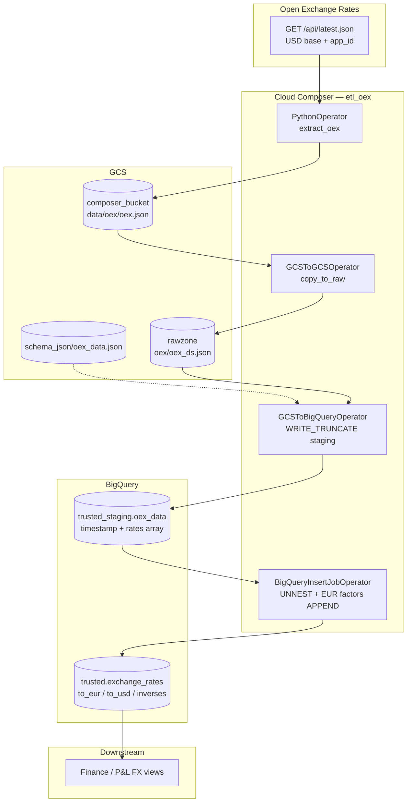

# Architecture: Open Exchange Rates FX land

Composer runs a four-task spine: Python extract to Composer data/,
GCS copy into date-keyed rawzone, nested NDJSON load into staging
(WRITE_TRUNCATE), then BigQuery INSERT that UNNESTs rates, derives
EUR/USD factors, and appends only new API timestamps into trusted.

## Diagram

## Components

**DAG (`dag_oex_fx_land.py`)**  
Schedule `0 5 * * *`, `catchup=False`. Project, buckets, datasets,
and connection ids from Airflow Variables. Sequential only — no
fan-out.

**Extract (`oex_extract.py`)**  
Reads `app_id` from connection password, calls latest.json, reshapes
`rates` map → repeated records, writes JSONL. Builds the trusted
INSERT SQL (UNNEST + EUR CROSS JOIN + timestamp NOT IN).

**Schema (`schema_json/oex_data.json`)**  
Integer `timestamp` + REPEATED RECORD `rates(currency, rate)`. Must
live on the GCS→BQ load bucket path used by the operator.

**Trusted contract**  
Columns: `timestamp`, `currency`, `to_eur`, `to_usd`,
`eur_to_currency`, `usd_to_currency`. Grain: one row per
(timestamp, currency).

## Failure modes

| Mode | Behaviour |
|------|-----------|
| Bad / missing app_id | Extract raises; no Composer file written |
| OEX non-200 | Extract raises (sanitized); production stayed green |
| EUR missing from payload | INSERT selects zero rows; staging still truncated |
| Same timestamp re-run | INSERT skips; trusted unchanged |
| Schema JSON missing | GCS→BQ load fails; rawzone object kept |
| Staging OK, insert fails | Re-run insert; staging holds latest truncate |
