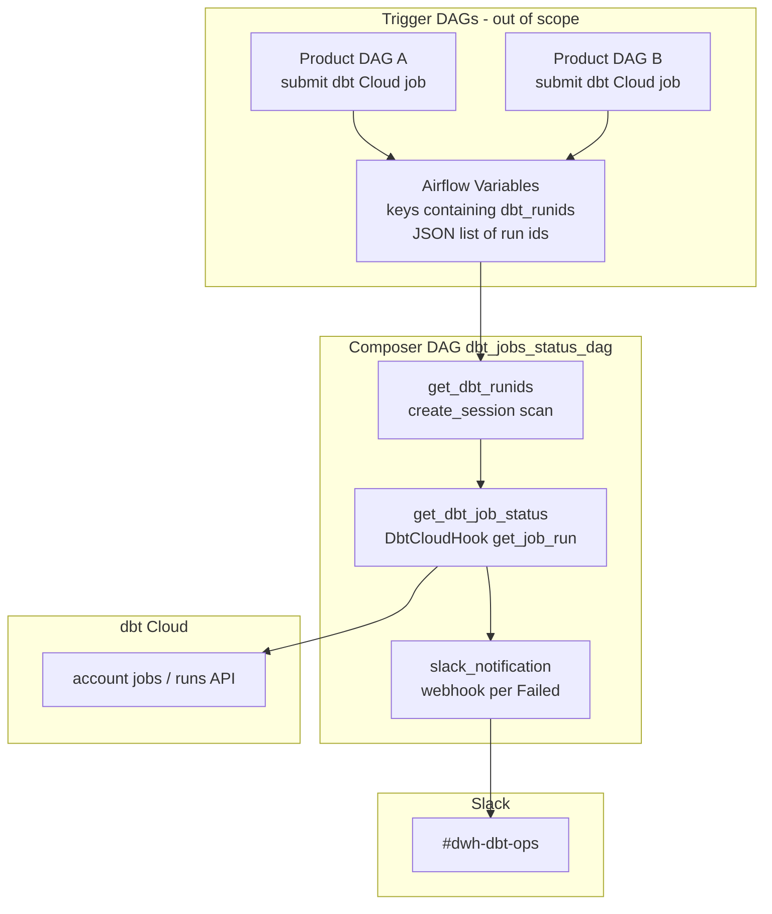

# Architecture: dbt Cloud run status Slack digest

Three Python tasks in a linear chain: discover run ids from Variables,
resolve status via dbt Cloud, post failures to Slack. No BigQuery,
no GCS, no dbt job submission.

## Diagram

## Components

**get_dbt_runids**  
Opens an Airflow DB session, lists Variable keys containing
`dbt_runids`, deserializes each as JSON, flattens with `sum(..., [])`.
`JSONDecodeError` is swallowed per Variable so one corrupt entry does
not blank the whole poll.

**get_dbt_job_status**  
For each run id: `DbtCloudHook.get_job_run`, then `get_job` for the
human name (falls back to numeric `job_id`). Maps
`is_success / is_error` to Succeeded vs Failed. Returns only Failed
rows on XCom.

**slack_notification**  
If the Failed list is empty, no-op. Otherwise instantiates
`SlackWebhookOperator` per row and `.execute({})` inside the
callable — same delivery shape as pattern 83.

## Design notes

Variable-key convention over a registry table keeps this DAG from
depending on warehouse freshness. The tradeoff is discoverability:
ops must know the naming rule, and stale run ids linger until a
trigger overwrites them. If you outgrow Variables, land run ids into
a small BQ control table and poll that instead — keep the Failed-
only Slack contract.
