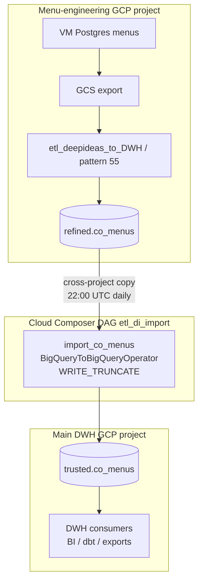

# Architecture: menu-engineering cross-project BQ bridge

Composer owns schedule and retries. Stock
`BigQueryToBigQueryOperator` does the cross-project full replace.
No custom operator, no TaskGroup, no dbt on the DWH side — those live
upstream in the menu-engineering project (pattern 55).

## Diagram

## Components

| Piece | Role |
|-------|------|
| `dag_deepideas_cross_project_bq_bridge.py` | ENV → projects/conn, single truncate copy |
| `BigQueryToBigQueryOperator` | Cross-project table copy, CREATE_IF_NEEDED |
| Composer SA | Read on `menu_eng_project.refined`; write on `dwh_project.trusted` |
| Variable `menu_eng_gcp_project` | Override source project without editing the DAG |

## Design notes

- One task on purpose. A bridge that needs a registry or TaskGroup has
  stopped being a bridge — graduate it to a pattern-81 style
  `copy_jobs` list when a second table shows up.
- Destination project is explicit in the operator config. Production
  relied on the connection default; making it visible avoids the
  "which project did DEV write to?" pager at 22:05.
- `max_active_runs=1` stops a slow copy from overlapping the next
  night's truncate.
- Schedule-as-sensor is a real tradeoff, not an omission I paper over
  in docs. Add `ExternalTaskSensor` when upstream SLAs start slipping;
  do not pretend the cron alone is strong coupling.
